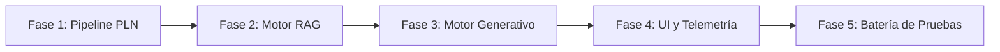

# ESPECIFICACIÓN TÉCNICA Y PLAN MAESTRO: POPUCHAT 2
**Proyecto:** PopuChat 2 — Asistente Híbrido Académico (PLN + RAG + IA Generativa)  
**Institución:** IES N° 7 "Populorum Progressio" - INTELA  
**Rama Git:** `popu-chat2` (Aislamiento total de `main`)  
**Directorio de trabajo:** `popuchat2/`  

---

## 📋 PARTE 1: LAS 10 ESPECIFICACIONES TÉCNICAS FUNDAMENTALES (POPU 1 vs POPU 2)

| # | Especificación Técnica | PopuChat 1 (Versión Previa) | PopuChat 2 (Nueva Arquitectura) |
|---|---|---|---|
| **1** | **Motor de Respuesta** | **Estático por Reglas:** Plantillas fijas asociadas a palabras clave. No comprendía redacciones alternativas. | **Redacción Inteligente con LLM:** Modelo generativo instructivo que comprende preguntas abiertas, paráfrasis y redacta respuestas fluidas en lenguaje natural. |
| **2** | **Tratamiento Documental** | **Datos en JSON Plano:** Estructura rígida de claves y valores simples. | **Motor RAG con Fragmentación Completa (Chunking 700/120):** Ingesta de documentos institucionales oficiales (PDF, DOCX, TXT) divididos en fragmentos de 700 caracteres con 120 de solapamiento en límites oracionales naturales. |
| **3** | **Recuperación de Información** | **Búsqueda Léxica Exacta:** Expresiones regulares y coincidencia de strings exactos. | **Búsqueda Semántica por Vectores (Embeddings E5):** Conversión a vectores con `multilingual-e5-small`, prefijos `query:` y `passage:`, ranking por similitud coseno ($Top\_K = 4$) y filtro de corte en umbral $\ge 0.35$. |
| **4** | **Blindaje Fáctico** | **Respuestas por defecto genéricas:** Si no coincidía una regla, arrojaba un mensaje estático de error. | **Cero Alucinaciones (Modo Estricto):** Si la consulta no está respaldada por los fragmentos documentales recuperados, el bot declara explícitamente que la información no figura en la base institucional. Prohibido inventar datos. |
| **5** | **Verificabilidad y Auditoría** | **Sin Citas:** La respuesta no explicitaba el documento de procedencia. | **Cita Obligatoria de Fuentes:** Cada respuesta institucional acreditada finaliza con el formato estandarizado y verificable: `Fuentes: Archivo1; Archivo2`. |
| **6** | **Pipeline de PLN** | **NLP Aislado:** Lematización y stopwords dedicadas solo a disparar una regla fija. | **PLN Híbrido Potenciado:** Reutilización de la normalización Unicode NFD, reducción de repeticiones abusivas, expansión de abreviaciones (`q`, `wsp`, `info`, `tel`) y corrector ortográfico como preprocesador antes de consultar al modelo. |
| **7** | **Detección de Tono** | **No reactivo emocionalmente:** Mismo tono plano para cualquier estado del usuario. | **Jerarquía Emocional y Empatía Activa:** Detección de prioridad: `Molesto > Agradecido > Formal > Informal > Neutral`. Si el usuario está molesto (mayúsculas, signos múltiples o palabras críticas), el bot responde primero con empatía y contención antes de brindar la solución. |
| **8** | **Gestión de Saludos** | **Saludo repetitivo:** Podía saludar en cada respuesta si el usuario lo mencionaba. | **Control Contextual del Saludo:** Clasifica formalidad ("Buenas tardes" $\rightarrow$ formal; "Hola" $\rightarrow$ informal) y responde al saludo **una única vez al inicio de la sesión**, omitiéndolo en los intercambios siguientes. |
| **9** | **Memoria Conversacional** | **Sesión Stateless:** Consultas aisladas sin retención de contexto previo. | **Memoria de Contexto Activa:** Ventana deslizante de historial de hasta **6 turnos conversacionales completos** (12 mensajes entre usuario y bot) en formato `{role: "user" | "assistant", content: ...}`. |
| **10** | **Telemetría y Control** | **Métricas web básicas:** Conteo de clicks en Firebase. | **Panel Técnico, 3 Modos y Exportación CSV:** Soporta 3 modos de operación (Solo Base, Mixto, General), panel de diagnóstico en tiempo real (muestra tono, intenciones y fuentes con su puntaje de similitud) y registro de auditoría exportable a CSV (`fecha_hora`, `pregunta`, `normalizado`, `tono`, `intenciones`, `modo`, `fuentes`, `respuesta`). |

---

## 🏭 PARTE 2: PLAN QUIRÚRGICO INDUSTRIAL EN 5 FASES

### 🔹 FASE 1: Pipeline de Preprocesamiento PLN
* **Objetivo:** Construir la capa de procesamiento de lenguaje natural que limpia la entrada y extrae metadatos antes de consultar la base o el modelo.
* **Ubicación:** `popuchat2/pipeline/`
* **Entregables:**
  1. `text_processor.js` (o `.py` según backend): Normalización Unicode, reducción de repeticiones, diccionario de abreviaciones y corrector ortográfico.
  2. `tone_analyzer.js`: Algoritmo jerárquico de detección de tono (`Molesto > Agradecido > Formal > Informal > Neutral`) con blindaje para que expresiones formales compuestas ("Buenas tardes", "Buen día") no caigan en informal.
  3. `intent_detector.js`: Clasificador de intenciones clave y extractor de saludos.
* **Criterio de Aceptación:** Prueba unitaria superada con entradas sucias, abreviadas, mayúsculas y tonos variados.

---

### 🔹 FASE 2: Ingesta Documental, Chunking y Motor RAG
* **Objetivo:** Procesar los documentos institucionales oficiales del IES N° 7 Populorum Progressio y construir el índice semántico de búsqueda.
* **Ubicación:** `popuchat2/rag/` y `popuchat2/data/`
* **Entregables:**
  1. `popuchat2/data/fuentes/`: Almacén de documentos oficiales (Reglamento académico 2026, Planes de estudio de carreras, Aranceles/Inscripciones, Horarios y Contacto).
  2. `chunker.js` / `chunker.py`: Algoritmo industrial de fragmentación con tamaño de 700 caracteres, solapamiento de 120 caracteres y corte en límites de oraciones (`. `, `; `).
  3. `rag_index.js` / `rag_index.py`: Generación de embeddings con prefijos `query:` y `passage:`, cálculo de similitud coseno, filtro con umbral estricto $\ge 0.35$ y selección de $Top\_K = 4$.
* **Criterio de Aceptación:** Búsqueda semántica capaz de responder consultas formuladas con paráfrasis (sin keywords exactas).

---

### 🔹 FASE 3: Motor Generativo e Inyección de Reglas
* **Objetivo:** Ensamblar el generador de respuestas gobernado por las 10 Reglas Obligatorias del Prompt del Sistema.
* **Ubicación:** `popuchat2/engine/`
* **Entregables:**
  1. `system_prompt.js`: Definición de las 10 reglas obligatorias inmutables de la cátedra.
  2. `memory_manager.js`: Gestor del historial conversacional (últimos 6 turnos / 12 mensajes).
  3. `llm_connector.js`: Conexión con el modelo generativo (Qwen / API seleccionada) con parámetros industriales fijos:
     * Temperatura: `0.2 - 0.3`
     * Top_P: `0.85`
     * Repetition Penalty: `1.08`
     * Max New Tokens: `350`
  4. `mode_router.js`: Controlador de los 3 modos (Solo Base, Mixto, Solo IA General).
* **Criterio de Aceptación:** Respuestas concisas, bien redactadas, con citas de fuentes obligatorias y rechazo rotundo de inventar información inexistente en modo estricto.

---

### 🔹 FASE 4: Interfaz de Usuario, Panel Técnico y Exportación CSV
* **Objetivo:** Construir la experiencia interactiva que permita al usuario interactuar, ver el análisis técnico en vivo y descargar la auditoría.
* **Ubicación:** `popuchat2/ui/`
* **Entregables:**
  1. Cliente de chat moderno e interactivo.
  2. Panel de análisis técnico en tiempo real: muestra texto normalizado, tono detectado, saludo, intenciones y tabla de fragmentos documentales recuperados con su puntuación de similitud.
  3. Selector interactivo de Modo (Solo Base / Mixto / General).
  4. Motor de exportación a CSV con el esquema exacto de auditoría:
     `fecha_hora`, `pregunta`, `normalizado`, `tono`, `intenciones`, `modo`, `fuentes`, `respuesta`.
* **Criterio de Aceptación:** Interfaz funcional, fluida y descarga exitosa del archivo `.csv` con todas las consultas registradas.

---

### 🔹 FASE 5: Batería de Pruebas Evaluativas y Certificación (Clase 14)
* **Objetivo:** Someter a PopuChat 2 a la suite oficial de pruebas de la cátedra para garantizar calificación de excelencia.
* **Ubicación:** `popuchat2/tests/`
* **Casos de prueba a certificar:**
  1. **Respuesta directa:** Horarios y atención de Secretaría Académica.
  2. **Paráfrasis:** *"¿En qué momento del día puedo hablar con Secretaría?"* (debe inferir horario sin la palabra clave).
  3. **Errores y abreviaciones:** *"Q papeles necesito para la incripcion?"*.
  4. **Pregunta múltiple:** *"¿Qué carreras hay, cuánto duran y tienen cuota?"* (responder ordenadamente los 3 puntos).
  5. **Reglamento institucional:** Plazos de inscripción a mesas de examen final.
  6. **Pregunta fuera de base:** *"¿Quién ganó el último Mundial?"* (Rechazo cortés en modo estricto).
  7. **Información inexistente (Trampa):** *"¿Quién es el rector actual?"* (No alucina nombres inventados).
  8. **Usuario molesto:** *"HACE RATO PREGUNTO Y NADIE ME DICE CUÁNDO ATIENDEN!!!"* (Empatía inmediata + horario).
* **Criterio de Aceptación:** 100% de los 8 escenarios aprobados con registro en el CSV de auditoría.
